# 🎬 Cinematic Scrollytelling Website & Experience Director

[](LICENSE)
[](#-the-26-scrollytelling-styles)
[](#-technique-recipes-index-r1--r20)
[](#-rendering-stack-guidelines)
[](#-the-taste-bar--signature-moves)

An autonomous AI creative director, motion choreographic engine, and front-end engineering framework built to design, storyboard, and generate award-winning **cinematic scrollytelling websites**, 3D interactive portals, scroll-scrubbed web cinema, and immersive digital narratives.

---

## 🌟 What is Cinematic Scrollytelling?

Traditional websites are flat, static grids that present information through passive reading. **Cinematic Scrollytelling** transforms web pages into responsive, living cinema where:

* **The scrollbar is the playback timeline:** Scrolling scrubs video frames, drives Three.js 3D cameras, morphs data charts, moves light spotlights, and shifts dimensional planes.
* **Story leads composition:** Every scene answers a narrative question before revealing technical features or calls-to-action.
* **Choreographed motion replaces decoration:** Elements don't arbitrarily bounce or fade in; they move according to strict physical pacing, acceleration tiers, and spatial relationships.
* **Performance meets craft:** Fluid 60 FPS interactions with zero scroll hijacking, native touch momentum preservation, and strict asset budgets.

---

## 🚀 Key Highlights & Capabilities

### 1. 🧠 Automatic Style Engine (26 Styles + 4 Overlays)
Never start from a generic blank canvas. Provide any topic (e.g., *"Quantum Computing Lab"*, *"Luxury Timepiece Reveal"*, *"Deep Sea Exploration"*, *"Indie Coffee Roastery"*), and the engine autonomously selects the optimal style archetype, generates an immutable **Style Decision Record (SDR)**, and builds the experience.

### 2. ⚡ 20 Battle-Tested Technique Recipes (R1 – R20)
Production-ready, copy-pasteable vanilla JavaScript and CSS implementations of the most challenging motion engineering patterns:
* Frame-accurate scroll-scrubbed HTML5 video (`requestVideoFrameCallback`)
* Canvas 2D image sequence scrubbers with linear interpolation (lerp)
* Two-row bidirectional infinite marquees with physics-based speed warping
* Magnetic hover cursors with spring dampening
* Sticky stacking case-study cards with progressive scale/dimming
* Three.js canvas warp portals and destination jump state machines
* Interactive exploded 3D model inspectors

### 3. 🎯 Distilled Taste Profile & Visual Quality Bar
Distilled from real-world Awwwards Site of the Year and FWA winning projects:
* **Monumental Typography:** 14–18vw display headings with metallic/silver gradients.
* **Tactile Micro-Interactions:** Magnetic CTAs, custom fluid cursor states, glassmorphism with subtle specular highlights (`rgba(255,255,255,0.08)` borders).
* **Dimensional Inversion Seams:** Seamless transition between pitch-black dark mode (#0A0A0A) and crisp high-contrast white (#FFFFFF) sections using organic curved seams (`rounded-t-[60px]`).

### 4. 🛠️ Three Complete Turnkey Reference Architectures
Shipped with exact, verbatim prompt guides and code architectures:
1. **Monumental 3D Portfolio:** Jack-style creative director showcase with 16vw typography, magnetic cutout tracking, and stacking case studies.
2. **Interstellar Warp Portal:** Multi-destination planetary switcher with procedural particle warp tunnels and spatial soundscapes.
3. **NovaAI Scroll-Scrubbed Cinema:** Video-driven landing page with frosted glass HUD controls and frame-locked narrative chapters.

---

## 🎨 The 26 Scrollytelling Styles

| Style ID | Name | Core Emotion / Feel | Best Used For | Signature Device |
|:---|:---|:---|:---|:---|
| **S01** | Monumental Gradient Type Portfolio | Confident, sculptural, dark | Designers, 3D artists, studios, personal brands | 14-18vw display type with magnetic portrait cutout overlap |
| **S02** | Portal / Destination Hop | Wonder, transportive, epic | Space, travel, gaming worlds, virtual architecture | Canvas particle warp tunnel switching between real-time 3D realms |
| **S03** | Scroll-Scrubbed Film Background | Cinematic, premium, hyper-focused | High-tech hardware, automotive, AI platforms, luxury | Native video scrubbed by scroll progress + floating glass telemetry HUD |
| **S04** | Pinned Chapter Storytelling | Methodical, authoritative | In-depth investigative journalism, essays, case studies | Sticky stage left/right with scrolling narrative cards driving stage transitions |
| **S05** | Image-Sequence Product Reveal | High-precision, industrial | Consumer electronics, mechanical watches, luxury goods | 120-240 frame canvas scrubber showing 360-degree rotation or teardown |
| **S06** | 3D Object Showcase (Three.js) | Tactile, spatial, futuristic | Industrial products, architecture, robotics, interactive art | Orbit camera transitions, exploded view component breakdowns on scroll |
| **S07** | Layered Parallax Descent | Atmospheric, immersive, deep | Oceanography, speleology, atmospheric science, folklore | 5-7 layered SVG/PNG depth planes moving at decreasing scroll speeds |
| **S08** | Horizontal Scroll Gallery | Curated, gallery-like, relaxed | Photography, fashion editorial, exhibition catalogues | Smooth horizontal rail pinned on vertical scroll with dynamic scrub indicators |
| **S09** | Stacking Case-Study Cards | Structured, tactile, satisfying | Agency work, project portfolios, tiered feature offerings | Cards that stick to top with decreasing scale and subtle backdrop blur stack |
| **S10** | Type-as-Window / Mask Reveal | Dramatic, reveal-driven, bold | Brand manifestos, film releases, architectural openings | Gigantic typography whose letterforms serve as an SVG clipping mask for video |
| **S11** | Kinetic Type Brutalist | Raw, energetic, provocative | Underground music, street culture, radical design studios | High-contrast black/white, rapid marquee ribbons, monospace timestamps |
| **S12** | Editorial Long-Read | Literary, cerebral, distinguished | Cultural journals, scientific essays, long-form journalism | Centered serif column, sticky margin annotations, drop caps, pull-quote pins |
| **S13** | Data Narrative | Analytical, persuasive, illuminating | Economics, climate reports, algorithmic benchmarks | Animated SVG/Canvas charts that transform (bar -> scatter -> sankey) on scroll |
| **S14** | Blueprint / Technical Instrument | Rigorous, engineering-focused | Aerospace, dev tools, precision machinery, cryptography | Monospace typography, green/amber phosphor palette, HUD crosshairs, wireframes |
| **S15** | Luxury Quiet | Restrained, opulent, timeless | Haute horlogerie, bespoke architecture, fine jewelry | Generous whitespace, serif typography, slow graceful fades, micro-gold accents |
| **S16** | Retro-Future / Archival | Nostalgic, tactile, tactile-warm | Historical deep-dives, vintage computing, space programs | Film grain shaders, CRT scanline overlays, warm paper textures, monospaced metadata |
| **S17** | Shader / Liquid Distortion | Hypnotic, experimental, fluid | Web3, electronic music, digital fashion, creative agencies | WebGL fragment shaders with mouse-driven liquid ripple displacement maps |
| **S18** | Zoom-Through / Scale Journey | Mind-bending, continuous | Physics (subatomic to cosmic), macro photography | Infinite zoom canvas transitions piercing through letters, cells, or stars |
| **S19** | Route / Map Journey | Expeditional, sequential | Travel expeditions, supply chain tracking, marathon routes | Vector map with dynamic SVG dashed path drawing and camera following coordinates |
| **S20** | Timeline River | Historical, evolving, narrative | Company histories, biological evolution, art movements | Continuous central winding spine branching into interactive milestone cards |
| **S21** | Bento Reveal Grid | Dense, modern, product-first | SaaS feature overviews, gadget specifications, developer tools | Asymmetric grid of glass containers that illuminate and activate on scroll entry |
| **S22** | Terminal / Cyber / Code | Underground, technical, hacker | Security tools, CLI software, developer ecosystems | CRT glow, interactive command prompt, typing animations, green-on-black |
| **S23** | Playful Kinetic / Toy | Whimsical, delightful, approachable | Children's brands, creative education, casual gaming | Physics-enabled draggable bouncy elements, pastel palettes, spring easing |
| **S24** | Organic Documentary / Nature | Grounded, serene, ecological | Wildlife conservation, national parks, botanical brands | Earth tones, soft organic wave dividers, soundscape audio integration |
| **S25** | Spotlight / Cursor-Lit Reveal | Mysterious, dramatic, intimate | Mystery releases, dark-mode fashion, investigative projects | Radial darkness mask following cursor or scroll revealing hidden textures underneath |
| **S26** | Interactive Explainer Lab | Educational, sandbox, experimental | Physics simulations, educational tools, interactive math | Real-time interactive sliders, sandbox canvas widgets, instant parameter updates |

### Visual Overlays (Cross-cutting modifiers)
* **O1: Glass / Spatial HUD:** Frosted backdrop-blur pills, thin specular highlights, translucent telemetry.
* **O2: Monospace Telemetry:** Engineering indices, timestamp counters, coordinate brackets.
* **O3: Film Grain & Analog Noise:** Subtle procedural SVG/Canvas perlin noise texture for organic warmth.
* **O4: Ambient Audio Atmosphere:** Web Audio API soundscapes with volume ducking and spatial triggers.

---

## 🏗️ 9-Phase Director Workflow

When crafting an experience, the Director executes this systematic 9-phase pipeline:

```mermaid
graph LR
    P1[Phase 1: Understand & Brief] --> P2[Phase 2: Reference Study]
    P2 --> P3[Phase 3: Art Direction]
    P3 --> P4[Phase 4: Cinematic Storyboard]
    P4 --> P5[Phase 5: Asset Engineering]
    P5 --> P6[Phase 6: Rendering Engine]
    P6 --> P7[Phase 7: Motion Choreography]
    P7 --> P8[Phase 8: Vertical Slice Build]
    P8 --> P9[Phase 9: Browser Verification]
```



1. **Understand & Inspect:** Establish objective, target audience, visual intensity score (1 to 5), and core constraints.
2. **Reference Deconstruction:** Analyze inspiring references for techniques, lighting, and pacing without superficial cloning.
3. **Original Art Direction:** Define color tokens with explicit contrast ratios, font pairings, and a single unforgettable **signature idea**.
4. **Cinematic Storyboard:** Detail every scene like a film shot: camera movement, scroll triggers, copy beats, and exit handoffs.
5. **Asset Strategy & Fallbacks:** Source verified media or build procedural Canvas/SVG/CSS stand-ins that guarantee 100% uptime.
6. **Rendering Engine Selection:** Choose the leanest stack for the job (DOM vs. Canvas2D vs. WebGL vs. Video).
7. **Motion Choreography:** Define 2–3 easing curves, 3 duration tiers, and strict scroll-linkage rules. Respects `prefers-reduced-motion`.
8. **Vertical Slice Implementation:** Build the hero and first signature scene at 100% production fidelity before expanding.
9. **Browser Verification & Polish:** Test on actual viewports (desktop, tablet, mobile), verify 60 FPS frame rates, and eliminate layout shift.

---

## 💻 Technique Recipes Index (R1 – R20)

Located in [`cinematic-experience-director/references/technique-recipes.md`](cinematic-experience-director/references/technique-recipes.md), each recipe contains battle-tested, dependency-free code:

* **R1: Scroll-Scrubbed Video:** Precise video currentTime pinning with `requestVideoFrameCallback` fallback.
* **R2: Canvas 2D Image Sequence:** Smooth linear interpolation (lerp) across preloaded JPEG/WebP frame sequences.
* **R3: Two-Row Bidirectional Marquee:** Infinite CSS keyframe ribbon with hover-pause and scroll-velocity amplification.
* **R4: Magnetic Cursor & Subject Tracker:** Spring-damped 2D cursor physics that gravitate toward interactive hit targets.
* **R5: Scroll-Filled Reading Typography:** Letter-by-letter or word-by-word opacity fill driven by scroll position.
* **R6: High-Contrast Inversion Seam:** Dramatic dark-to-light boundary with `rounded-t-[60px]` overlay masks.
* **R7: Stacking Sticky Cards:** Sticky stacked container with progressive scale-down (`transform: scale(calc(1 - 0.05 * i))`) and dimming.
* **R8: Three.js Canvas Warp Portal:** Starfield/particle tunnel with Z-depth acceleration into scene transitions.
* **R9: Destination Hop State Switcher:** Multi-world switcher with camera crossfades and atmospheric color transitions.
* **R10: Ambient Web Audio Engine:** Synthesized audio ambient drone using Web Audio API nodes with user interaction bypass.
* **R11: Three.js Model Viewer with Exploded View:** Mesh coordinate offsets triggered by scroll progress.
* **R12: Pinned Horizontal Scroll Track:** Clean GSAP or native CSS scroll-driven horizontal gallery container.
* **R13: Pinned Multi-Chapter Progression:** Left column pinned stage with right-side scrolling chapter markers.
* **R14: Split-Text Mask Reveal:** Typography sliding out from invisible overflow-hidden bounding boxes.
* **R15: Frosted Glass Overlay Card:** Multi-layer backdrop-filter with light border highlights and noise grain.
* **R16: WebGL Liquid Distortion:** Custom vertex/fragment shader with mouse displacement ripples.
* **R17: Morphing SVG Data Chart:** Path tweening between dataset states on scroll engagement.
* **R18: Technical HUD Blueprint Crosshairs:** Coordinate tickers, dynamic rulers, and SVG reticles.
* **R19: Preloader Screen with Asset Sync:** Percentage-based progress gate syncing images, video buffers, and fonts.
* **R20: Viewport Scale Zoom-Through:** Hero element scaling from 1.0 to 30.0x, allowing the viewport to pierce into the next scene.

---

## 📁 Repository Structure

```text
cinematic-scrollytelling/
├── README.md                                  # This documentation
├── HOW-TO-USE.md                              # Quick start & prompting cheat sheet
├── START-HERE.md                              # Agent handoff instructions
├── cinematic-experience-director.skill        # Packaged Claude/Agent skill artifact
└── cinematic-experience-director/             # Core director package
    ├── README.md                              # Skill overview
    ├── SKILL.md                               # The 9-phase operational workflow & instructions
    └── references/
        ├── art-direction.md                   # Visual hierarchy, typography, palette rules
        ├── assets.md                          # Sourcing, licensing, formats, fallback design
        ├── explainers-and-data.md             # Data visualization & educational models
        ├── motion-and-scroll.md               # Motion choreography, easing, scroll engines
        ├── style-library.md                   # Full encyclopedia of S01–S26 styles + overlays
        ├── style-selector.md                  # Automatic topic-to-style scoring matrix
        ├── taste-profile.md                   # The aesthetic bar, anti-patterns, signature moves
        ├── tech-and-performance.md            # Stacks, Three.js best practices, FPS budgets
        ├── technique-recipes.md               # R1-R20 verified code recipes
        ├── verification.md                    # Headless browser verification rubric
        └── source-prompts/                    # Verbatim source prompt architectures
            ├── 01-jack-3d-portfolio-react.md
            ├── 02-planet-jumping-portal-vanilla.md
            └── 03-novaai-scroll-scrubbed-video-react.md
```

---

## ⚡ Quickstart & Installation

### Option 1: Install in Claude.ai / Claude Desktop
1. Download `cinematic-experience-director.skill` from this repo.
2. Open Claude Settings → **Capabilities** → **Skills**.
3. Upload or import `cinematic-experience-director.skill`.

### Option 2: Install in Claude Code / Terminal Agent
Copy the `cinematic-experience-director` folder to your global or project skills directory:
```bash
# Global installation
cp -r cinematic-experience-director ~/.claude/skills/

# Project-specific installation
mkdir -p .claude/skills
cp -r cinematic-experience-director .claude/skills/
```

### Option 3: Use with Antigravity / Cursor / Custom AI Agents
Add `cinematic-experience-director/SKILL.md` to your agent rules (e.g., `.cursorrules`, `AGENTS.md`, or workspace instructions), keeping the `references/` directory adjacent.

---

## 🎯 How to Prompt the Director

Once the skill is active, you only need to describe your topic:

```text
"Create a scrollytelling website about the James Webb Space Telescope."
```

The Director immediately:
1. Matches the topic to **S02 (Portal / Destination Hop)** combined with **S14 (Blueprint Telemetry)** and **O1 (Glass HUD)**.
2. Emits the **Style Decision Record (SDR)**.
3. Produces the creative brief and scene storyboard.
4. Generates a self-contained, working web experience with 60 FPS scroll motion.

### Advanced Prompt Controls

* **Force a specific style:**
  > *"Create a portfolio for an industrial designer using S09 Stacking Cards and S14 Blueprint style."*
* **Adjust visual intensity:**
  > *"Make a scrollytelling landing page for an artisan coffee roastery. Visual intensity: 5/5 maximal."*
* **Switch styles after first build:**
  > *"Switch to S05 image sequence reveal with darker contrast."*
* **Recreate reference builds:**
  > *"Recreate the Planet Jumping portal prompt exactly as a single vanilla HTML file."*
* **Target custom stack:**
  > *"Build this using Next.js 14, Tailwind CSS, and Framer Motion."*

---

## 🛡️ The Taste Bar: What is Explicitly Avoided

To maintain an authentic Awwwards/FWA aesthetic, the director enforces strict aesthetic boundaries:
* ❌ **No generic gradient blobs:** Purple/cyan blurry background circles are prohibited unless specifically called for.
* ❌ **No identical fade-up animations:** Every element fading up 20px with the same easing curve makes pages feel amateur.
* ❌ **No scroll-jacking:** The native scroll wheel must remain responsive. Transformations link to native scroll offset rather than preventing user input.
* ❌ **No placeholder asset links:** Never hallucinates broken Unsplash URLs; all media uses verified CDNs or procedural SVG/Canvas generators.
* ❌ **No generic hero templates:** Rejects the formulaic "centered headline + subline + 2 buttons + 3 icon cards below".

---

## 📄 License

This project is licensed under the [MIT License](LICENSE). Feel free to adapt, extend, and build stunning scrollytelling experiences for client work, personal showcases, or open-source products.
