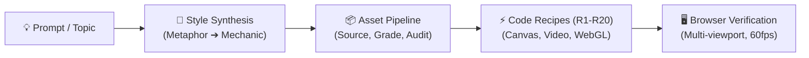

# 🎬 Cinematic Experience Director (v3)

[](https://github.com/udaydomadiya08/cinematic-scrollytelling)
[](LICENSE)
[](https://github.com/udaydomadiya08/cinematic-scrollytelling)
[](cinematic-experience-director/references/style-synthesis.md)
[](cinematic-experience-director/references/asset-pipeline.md)

> **An autonomous AI skill that creates distinctive, motion-rich, browser-verified scrollytelling websites for ANY topic.**  
> Give it a one-line prompt, and it invents a bespoke aesthetic tailored to the subject, sources or generates high-fidelity assets, crafts cinematic narrative scroll mechanics, and verifies the build in a real browser.

```
"Create a scrollytelling website about black holes." 
  ↳ Bespoke Style Synthesis (Gravitational Lens + Cosmic Void)
  ↳ Asset Pipeline (NASA/ESA imagery, procedural accretion disk shaders, Space Mono typography)
  ↳ Production Build (Interactive single-file experience, 60fps scroll lerp, real-world verified)
```

---

## 🌟 What Makes v3 Different?

Traditional AI web generators spit out generic templates: centered hero titles, purple-gradient glow blobs, and three uniform rounded feature cards. **Cinematic Experience Director v3 operates like an award-winning creative agency director**, executing an intelligent 9-phase production pipeline:



### 1. 🧬 Dynamic Style Synthesis (Not Fixed Templates)
Instead of picking from a rigid dropdown, v3 analyzes your subject matter to extract an intrinsic **verb and metaphor**, maps it to an enacting **scroll mechanic**, and generates a coherent **Style Brief** across 12 genomic axes:
* **Metaphor Mining:** Translating concepts into spatial movement (e.g., deep-sea cables = vertical descent through pressure zones; specialty coffee = temperature and filtration stages).
* **The Style Genome:** 12 expressive axes including Space/Camera, Scroll Mechanic, Media Type, Color World, Type Voice, Material/Texture, Composition, Motion Temperament, and Signature Interactions.
* **Seed Styles as Vocabulary:** 26 reference styles provide structural inspiration without ever acting as repetitive templates.

### 2. 🎨 Autonomous Asset Pipeline
Great motion design falls flat with poor imagery. Version 3 treats media as a first-class citizen:
* **Multi-Channel Sourcing:** Curates open-license stock footage, museum/astronomy archives (NASA, ESO, Smithsonian), 3D models, Google Fonts, and Fontshare typefaces.
* **Procedural & Generative Media:** Crafts real-time Canvas 2D/3D shaders, SVG vector paths, and procedural noise when external media is unavailable.
* **Unified Visual Grading:** Harmonizes contrast, color temperature, and grain so mixed-source media feels like a single cinematic film.
* **`ASSETS.md` Audit Manifest:** Automatically compiles license, source URL, resolution, and fallback state for every asset used.

### 3. 🎯 Smart Adaptive Intake (Infer vs. Ask)
No tedious questionnaires. The skill respects user time with an intelligent decision matrix:
* **Instant Build for Vague Prompts:** When given "make a site about jazz" or "just build it", it infers 100% of creative decisions and starts building immediately.
* **Max 4 High-Impact Questions:** Only asks about critical blockers that cannot be guessed (real company name, must-use brand assets, genuine taste forks) with sensible defaults pre-selected.

### 4. ⚡ 20 Battle-Tested Technique Recipes (R1–R20)
Production-ready, copy-pasteable vanilla JavaScript and CSS implementations of the most demanding motion engineering patterns—free from heavy, fragile external dependencies.

### 5. 🔍 Mandatory Browser Verification Loop
Builds are inspected across mobile (390px), tablet (768px), and desktop (1440px/1920px) viewports with strict checks for scroll jank, layout shift, contrast readability, asset fallbacks, and `prefers-reduced-motion` compliance.

---

## 🎨 The 26 Scrollytelling Seed Styles

These 26 styles serve as the director's foundational aesthetic vocabulary. In v3, they are mutated, cross-pollinated, and recombined into original designs:

| Style ID | Name | Core Emotion / Feel | Best Used For | Signature Device |
|:---|:---|:---|:---|:---|
| **S01** | Monumental Gradient Type | Confident, sculptural, dark | Designers, 3D artists, studios, personal brands | 14–18vw display type with magnetic portrait cutout overlap |
| **S02** | Portal / Destination Hop | Wonder, transportive, epic | Space, travel, gaming worlds, virtual architecture | Canvas particle warp tunnel switching between real-time 3D realms |
| **S03** | Scroll-Scrubbed Film | Cinematic, premium, focused | High-tech hardware, automotive, AI platforms, luxury | Native video scrubbed by scroll progress + floating glass telemetry HUD |
| **S04** | Pinned Chapter Storytelling | Methodical, authoritative | Investigative journalism, essays, case studies | Sticky stage left/right with scrolling narrative cards driving state |
| **S05** | Image-Sequence Reveal | High-precision, industrial | Consumer electronics, mechanical watches, luxury goods | 120–240 frame canvas scrubber showing 360-degree rotation |
| **S06** | 3D Spatial Showcase | Tactile, spatial, futuristic | Industrial products, architecture, robotics, interactive art | Orbit camera transitions, exploded view component breakdowns |
| **S07** | Layered Parallax Descent | Atmospheric, immersive, deep | Oceanography, geology, atmospheric science, folklore | 5–7 layered depth planes moving at decreasing scroll speeds |
| **S08** | Horizontal Rail Gallery | Curated, gallery-like, relaxed | Photography, fashion editorial, exhibition catalogues | Smooth horizontal rail pinned on vertical scroll with scrub indicators |
| **S09** | Stacking Case-Study Cards | Structured, tactile, satisfying | Agency work, project portfolios, tiered feature offerings | Cards that stick to top with decreasing scale and subtle backdrop blur |
| **S10** | Type-as-Window Reveal | Dramatic, reveal-driven, bold | Brand manifestos, film releases, architectural openings | Gigantic typography whose letterforms serve as an SVG clipping mask |
| **S11** | Kinetic Brutalist | Raw, energetic, provocative | Underground music, street culture, radical design studios | High-contrast black/white, rapid marquee ribbons, monospace timestamps |
| **S12** | Editorial Long-Read | Literary, cerebral, distinguished | Cultural journals, scientific essays, long-form journalism | Centered serif column, sticky margin annotations, drop caps |
| **S13** | Interactive Data Narrative | Analytical, persuasive, illuminating | Economics, climate reports, algorithmic benchmarks | Animated SVG/Canvas charts transforming (bar ➔ scatter ➔ sankey) |
| **S14** | Technical Blueprint / Instrument | Rigorous, engineering-focused | Aerospace, developer tools, precision machinery | Monospace typography, phosphor green/amber palette, HUD crosshairs |
| **S15** | Quiet Luxury | Restrained, opulent, timeless | Haute horlogerie, bespoke architecture, fine jewelry | Generous whitespace, serif typography, slow graceful fades |
| **S16** | Retro-Future / Archival | Nostalgic, tactile, warm | Historical deep-dives, vintage computing, space programs | Film grain shaders, CRT scanline overlays, warm paper textures |
| **S17** | Liquid / Shader Distortion | Hypnotic, experimental, fluid | Web3, electronic music, digital fashion, creative agencies | WebGL fragment shaders with mouse-driven ripple displacement maps |
| **S18** | Continuous Zoom-Through | Mind-bending, scale-defying | Physics (subatomic to cosmic), macro photography | Infinite zoom canvas transitions piercing through letters, cells, or stars |
| **S19** | Expedition / Map Journey | Expeditional, sequential | Travel expeditions, supply chain tracking, marathon routes | Vector map with dynamic SVG dashed path drawing and coordinate camera |
| **S20** | Timeline River | Historical, evolving, narrative | Company histories, biological evolution, art movements | Continuous central winding spine branching into interactive milestones |
| **S21** | Bento Reveal Grid | Dense, modern, product-first | SaaS feature overviews, gadget specifications, developer tools | Asymmetric grid of glass containers that illuminate on scroll entry |
| **S22** | Terminal / Cyber / CLI | Underground, technical, hacker | Security tools, CLI software, developer ecosystems | CRT glow, interactive command prompt, typing animations, green-on-black |
| **S23** | Playful Kinetic / Toy | Whimsical, delightful, approachable | Children's brands, creative education, casual gaming | Physics-enabled draggable bouncy elements, spring easing |
| **S24** | Organic Documentary | Grounded, serene, ecological | Wildlife conservation, national parks, botanical brands | Earth tones, soft organic wave dividers, soundscape audio integration |
| **S25** | Spotlight / Cursor-Lit | Mysterious, dramatic, intimate | Mystery releases, dark-mode fashion, investigative projects | Radial darkness mask following cursor revealing hidden textures |
| **S26** | Interactive Explainer Lab | Educational, sandbox, experimental | Physics simulations, educational tools, interactive math | Real-time interactive sliders, sandbox canvas widgets, instant updates |

### Visual Overlays (Cross-Cutting Modifiers)
* **O1: Glass / Spatial HUD:** Frosted backdrop-blur pills (`backdrop-filter: blur(16px)`), specular highlights (`rgba(255,255,255,0.08)` borders), floating telemetry tags.
* **O2: Monospace Telemetry:** Engineering indices (`01 // 04`), coordinate brackets `[42.3601° N, 71.0589° W]`, real-time timestamps.
* **O3: Film Grain & Analog Noise:** Subtle procedural SVG/Canvas perlin noise overlay for tactile, non-sterile warmth.
* **O4: Ambient Audio Atmosphere:** Web Audio API soundscapes with volume ducking, mute controls, and spatial triggers.

---

## ⚡ 20 Battle-Tested Technique Recipes (R1–R20)

Located in `cinematic-experience-director/references/technique-recipes.md`, each recipe is self-contained and engineered for 60fps performance:

```
R1  │ Scroll Progress + Lerp Loop       │ Smooth linear interpolation engine with normalized 0.0-1.0 progress
R2  │ Scroll-Scrubbed Video             │ Dual implementation: simple seek + high-performance frame-cache
R3  │ Letter-by-Letter Scroll Text      │ Pinned typography reveal with progressive opacity and blur decay
R4  │ Dual Velocity Marquee             │ Opposite-direction ribbons that accelerate/skew based on scroll speed
R5  │ Stacking Sticky Cards             │ 3D card deck pinning with progressive scale reduction and backdrop blur
R6  │ Spring-Damped Magnetic Element    │ Cursor pull effect with physics spring damping for buttons & tags
R7  │ Staggered Rise & Blur Reveal      │ Viewport-triggered element cascade using IntersectionObserver
R8  │ Canvas Portal Warp Tunnel         │ Procedural particle starfield tunnel with interactive destination jump
R9  │ Preloader Counter + Docked Logo   │ 0-100% numerical loader with seamless logo dock animation into navbar
R10 │ Contextual Dual Cursor            │ Leading dot + trailing lerped ring with hover states and text labels
R11 │ Pinned Horizontal Scroll Section  │ Seamless conversion of vertical scroll distance into horizontal rail translation
R12 │ Type-as-Window Video Mask         │ Gigantic headline SVG clipping mask revealing background video
R13 │ Canvas 2D Image-Sequence Player   │ Memory-efficient 120-240 frame playback with instant image preloading
R14 │ Pinned Chapters & Sticky Stage    │ Pinned visual media stage left with synchronized scrolling narrative steps right
R15 │ Core Design Tokens                │ Metallic display gradients, glassmorphism tokens, and organic curved seams
R16 │ Reduced-Motion Engine             │ Automatic fallback converting continuous motion into clean static states
R17 │ SVG Dynamic Path Drawing          │ Stroke-dashoffset scroll animation with traveling marker head
R18 │ Minimal Three.js Scroll Camera    │ Lightweight WebGL scene with scroll-driven camera spline navigation
R19 │ Interactive Spotlight Mask        │ Dynamic radial-gradient dark mask revealing underlying content under cursor
R20 │ Velocity-Skew Brutalist Marquee   │ Kinetic type with real-time CSS skew distortion mapped to scroll momentum
```

---

## 🏗️ 9-Phase Director Pipeline

Every generated website passes through this rigorous architectural workflow:

```
[Phase 1] Understand & Inspect ──➔ Determine objective, audience, and ask-vs-assume decisions
[Phase 2] Study References      ──➔ Extract technique & rules (what works vs. what NOT to copy)
[Phase 3] Original Art Direction──➔ Synthesize style brief, color palette, type pairing & signature idea
[Phase 4] Cinematic Storyboard  ──➔ Structure narrative as scenes, not generic sections
[Phase 5] Asset Acquisition     ──➔ Source stock/archives, generate procedural shaders, verify & audit
[Phase 6] Select Rendering Stack──➔ Smallest coherent stack (DOM, SVG, Canvas 2D, or WebGL)
[Phase 7] Motion System Design  ──➔ Curate 2-3 easings, 3-4 duration tiers, and signature transition
[Phase 8] Implementation        ──➔ Build working vertical slice first, then assemble full experience
[Phase 9] Browser Verification  ──➔ Multi-viewport inspection, 60fps check, and defect elimination
```

---

## 📁 Repository Structure

```
.
├── LICENSE                                    # Open source MIT license
├── README.md                                  # Complete architecture & documentation
├── HOW-TO-USE.md                              # Quick-start usage guide for humans
├── START-HERE.md                              # Bootstrapping instructions for any AI agent
├── cinematic-experience-director.skill        # Packaged skill archive for Claude / Antigravity
└── cinematic-experience-director/
    ├── SKILL.md                               # Master director workflow and execution rules
    ├── README.md                              # Skill overview and index
    └── references/
        ├── intake-questions.md                # Decision rules: when to assume vs. when to ask
        ├── style-synthesis.md                 # Bespoke style invention & the 12 Style Genome axes
        ├── style-library.md                   # 26 seed styles with signature devices & emotional profiles
        ├── style-selector.md                  # Topic-to-style recommendation matrix
        ├── taste-profile.md                   # Visual quality bar, typography rules, and anti-patterns
        ├── taste-examples/                    # Calibration benchmarks (Jack 3D, Planet Portal, NovaAI)
        ├── asset-pipeline.md                  # Sourcing, generation, visual grading & ASSETS.md rules
        ├── assets.md                          # Licensing constraints, optimization & 3D guidelines
        ├── technique-recipes.md               # Complete R1–R20 copy-pasteable motion code implementations
        ├── art-direction.md                   # Color roles, typography hierarchies, and composition rules
        ├── motion-and-scroll.md               # Motion choreography, easing mathematics & stagger timing
        ├── tech-and-performance.md            # 60fps budgets, memory management & DOM virtualization
        ├── verification.md                    # Mandatory multi-device testing & defect triage
        └── explainers-and-data.md             # Visualizing complex narratives, data & science
```

---

## 🚀 Installation & Multi-Agent Setup

### Option 1: Claude.ai / Claude Mobile
1. Open **Claude.ai** ➔ **Settings** ➔ **Capabilities** ➔ **Skills**.
2. Click **Add Skill** and upload the [`cinematic-experience-director.skill`](cinematic-experience-director.skill) package (or zip the `cinematic-experience-director/` folder).

### Option 2: Claude Code (CLI)
```bash
git clone https://github.com/udaydomadiya08/cinematic-scrollytelling.git
# Install for your user profile:
cp -r cinematic-experience-director ~/.claude/skills/
# Or install into a specific project workspace:
cp -r cinematic-experience-director <your-project>/.claude/skills/
```

### Option 3: Google Antigravity IDE / Gemini Agent
```bash
git clone https://github.com/udaydomadiya08/cinematic-scrollytelling.git
# Copy into Antigravity global customizations:
mkdir -p ~/.gemini/config/skills/
cp -r cinematic-experience-director ~/.gemini/config/skills/
```

### Option 4: Cursor, Windsurf, Codex, or OpenCode
Place `SKILL.md` and the `references/` directory in your agent's instructions folder (e.g., `.cursorrules`, `.windsurfrules`, or workspace prompts).

### Option 5: Zero-Install Mode (Any Chat LLM)
Simply attach this repository as a `.zip` archive to any ChatGPT, Claude, or Gemini prompt and type:  
`"Read START-HERE.md and build me a scrollytelling website about [your topic]"`

---

## 💬 Usage Examples

### 1. Minimal One-Line Request (Automatic Intake)
```
Create a scrollytelling website about the history and future of James Webb Space Telescope.
```
*The Director will automatically infer visual style, color palette (deep infrared, observatory brass, cosmic black), source imagery, design a zoom-through scale journey (S18/S02), build the complete single-file HTML experience, and verify it in the browser.*

### 2. High-End Creative Portfolio
```
Portfolio for a generative AI artist & creative technologist named Maya Lin. Dark, sculptural, monumental typography, visual intensity 5/5.
```

### 3. Business / Product Launch with Custom Stack
```
Launch site for our mechanical keyboard studio 'Kyoto Keebs'. Use React + Tailwind CSS + Framer Motion. Include an interactive exploded switch view (R6/S06) and sound design.
```

### 4. Planning Only (Architecture & Storyboard First)
```
Plan only: Scrollytelling website documenting the discovery of hydrothermal vents. Provide style brief, asset plan, and scene storyboard.
```

---

## 📐 Quality Standards & Anti-Patterns

To guarantee an Awwwards / FWA-level aesthetic, the Director strictly avoids generic AI design tropes:

| ❌ What is BANNED | ✅ What is ENFORCED |
|:---|:---|
| Purple/cyan glow blobs on plain black | Curated color worlds derived from physical subject materials |
| Centered headline + 3 identical cards | Asymmetric editorial grids, monumental typography, dimensional layers |
| Generic placeholder rectangles | High-resolution vetted stock, NASA/museum media, or procedural canvas shaders |
| Monotonous fade-up on every section | Deliberate motion choreography with varied pace, scale, and moments of quiet |
| Scroll hijacking (wheel prevention) | Native momentum scroll driving lerped transforms and scrubbed media |
| Broken links and dead assets | Fallback gradients, inline SVG, and a verified `ASSETS.md` manifest |

---

## 📜 License

This project is licensed under the [MIT License](LICENSE) — free for personal, commercial, and educational use.

Made with 🎬 for designers, creative technologists, and developers who refuse to build boring websites.
